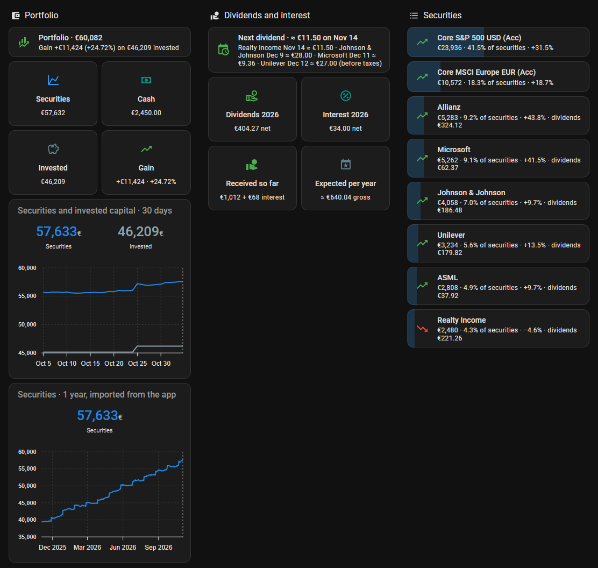
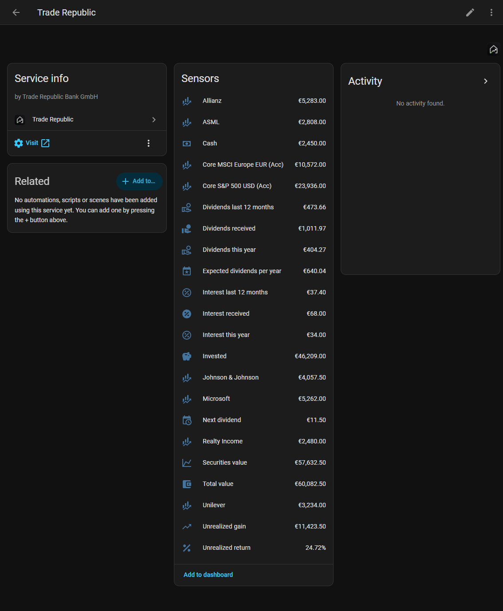

# Trade Republic for Home Assistant

[](https://github.com/flaviorighi/ha-trade-republic/releases)
[](https://analytics.home-assistant.io/)

Brings the portfolio of a [Trade Republic](https://traderepublic.com) account into Home Assistant: total value, cash, invested capital, unrealized gain, dividends and interest received, the dividends to come, and one sensor for every security you hold.



*A dashboard built from the sensors, with made-up data. The cards are [Mushroom](https://github.com/piitaya/lovelace-mushroom), [ApexCharts](https://github.com/RomRider/apexcharts-card), [card-mod](https://github.com/thomasloven/lovelace-card-mod) and [auto-entities](https://github.com/thomasloven/lovelace-auto-entities): they are not part of the integration.*

> [!WARNING]
> **Read this before you install it: your account, your data, your responsibility.**
>
> - **The integration sees your whole account**: balances, securities, transactions, dividends and interest.
> - **Your data goes nowhere else.** The integration talks only to Trade Republic. Nothing is sent to the author or to any other service.
> - **The read-only limit is in this code, not in your session.** The session Home Assistant keeps is the same as a browser logged into Trade Republic: whoever copies it from your configuration or a backup can do what the Trade Republic web app allows, until it expires. Protect access to your Home Assistant, its add-ons and its backups, and encrypt your backups.
> - **Your amounts become Home Assistant entities.** Everyone who can use your Home Assistant sees them, they are kept in its database and backups, and they reach anything you share entities with, such as voice assistants or cloud services.
> - **No warranty.** This is an unofficial project, provided as it is under the MIT license. Use it at your own risk.
>
> Details in [Read-only by design](#read-only-by-design).

> **Unofficial.** This project is not affiliated with Trade Republic Bank GmbH. It uses the same private API as Trade Republic's web app, through [pytr](https://github.com/pytr-org/pytr). Trade Republic can change or block that API at any time, and the integration then stops working until it is updated. Trade Republic is a trademark of Trade Republic Bank GmbH, used here only to name the service the integration reads.

## Read-only by design

- **It cannot trade or move money.** pytr can place orders, change savings plans and request payouts. This integration wraps pytr in a client that refuses every request outside a short list of read-only ones (portfolio, cash, instrument details, prices, the list of transactions, stock details), and the tests check that every order, savings plan, alarm, watchlist and payout call is refused. Outside that connection it only reads the account settings and the portfolio chart.
- **Your PIN is never stored.** It is sent once to Trade Republic to log in, and the login is confirmed in the Trade Republic app. Afterwards the integration only uses the session cookies. When the session expires, Home Assistant asks for the PIN again.
- **The session is stored.** The cookies live in `.storage/trade_republic/` inside your Home Assistant configuration, so they are also in your backups. Like the session of a browser logged into Trade Republic, they give access to the account until they expire: protect your configuration and encrypt your backups.
- **Dependencies are pinned** to exact versions, so the code that runs changes only with a release of this integration.
- **Diagnostics contain no amounts, securities or account details**, so they can be attached to a public issue.

## Installation

### HACS

1. In HACS, open the menu → **Custom repositories**, add `https://github.com/flaviorighi/ha-trade-republic` with type **Integration**.
2. Install **Trade Republic** and restart Home Assistant.

### Manual

Download `trade_republic.zip` from the [latest release](https://github.com/flaviorighi/ha-trade-republic/releases/latest), extract it into `custom_components/trade_republic` in your configuration and restart Home Assistant.

## Setup

1. **Settings → Devices & services → Add integration → Trade Republic.**
2. Enter your phone number in international format (for example `+49 151 23456789`) and your PIN.
3. Confirm the login in the Trade Republic app on your phone. The setup continues on its own; the request expires after about 2 minutes. Accounts that use an authenticator app are asked for its code instead.

Logging in from Home Assistant does not log you out of the app on your phone.

## Entities



All amounts are in the account currency.

| Entity | Meaning |
| --- | --- |
| Total value | Cash plus the market value of all securities |
| Securities value | Market value of all securities |
| Cash | Available cash |
| Invested | What the securities cost, from their average purchase price |
| Unrealized gain | Securities value minus invested, for the securities with a purchase price |
| Unrealized return | Unrealized gain as a percentage of invested |
| Dividends this year, Dividends last 12 months, Dividends received | Dividends credited to the account, after taxes. *Dividends received* counts since the account was opened, with `by_year` and the last payment as attributes |
| Interest this year, Interest last 12 months, Interest received | Interest on cash credited to the account, the same way |
| Next dividend | The soonest dividend announced for a security you hold: quantity times dividend per share, before taxes. Attributes: `name`, `ex_date`, `payment_date`, `per_share`, and `upcoming` with every announced dividend |
| Expected dividends per year | Quantity times the yearly dividend per share that Trade Republic projects for each security, before taxes, with `by_security` |
| *One per security* | Market value, with `isin`, `quantity`, `average_price`, `price`, `invested`, `gain` and `gain_percent` as attributes, and for dividends `dividends_received`, `expected_annual_dividend`, `next_dividend_date` and `next_dividend` |

A sensor appears when you buy a new security. When you sell all of it, its sensor becomes unavailable and is removed at the next restart.

Prices are the last trade on the security's first exchange, usually Lang & Schwarz. Bonds are quoted in percent and converted. If a price does not arrive, the last known one is kept.

### Dividends and interest

Payments received come from the list of transactions in the app: the whole list is read at the first update and once a day, and only its newest page in between. They are the amounts credited, so dividends are after the taxes withheld. Until the list has been read, these sensors are unknown rather than zero.

The dividends to come are those that Trade Republic shows on the page of each security: the next dividend once it is announced, and a projection for the year. They are estimates before taxes, computed with the quantity you hold today. Accumulating funds and most bonds pay nothing, so they do not appear.

## History

Home Assistant keeps statistics only from the moment the integration is set up. On the first start the integration therefore reads, once, the portfolio chart shown in the Trade Republic app and imports it into the long-term statistics of the sensors it describes, up to the first statistic Home Assistant recorded itself. Statistic graphs then show the portfolio before the integration existed.

- **Securities value**: one point a day for the last year, sparser points before.
- **Invested** and **unrealized gain**: only from the sparse points that go back to the first purchase, because Trade Republic counts the performance of each chart from its own start.

A series is imported only if its latest point agrees with today's value of the sensor within 1% of the securities value, so a change in what Trade Republic sends cannot fill a sensor with the wrong numbers. When nothing can be imported, the integration logs a warning and tries again at the next start. There is no history for cash or for single securities.

## Options

**Update interval**: how often the portfolio is read, 30 minutes by default (15 minutes to 24 hours). Every update opens one connection and sends one request per security and one for the newest transactions; the stock details of each security are read twice a day.

## When the session expires

Trade Republic ends web sessions after a while. Home Assistant then shows a repair to log in again: enter your PIN and confirm in the app. Until then the sensors are unavailable.

## Troubleshooting

Enable debug logging to see what is exchanged with Trade Republic (it includes your positions, but never the PIN or the cookies):

```yaml
logger:
  logs:
    custom_components.trade_republic: debug
```

## Roadmap

- Savings plans
- History of dividends and interest in the long-term statistics
- A dashboard card, shipped with the integration: the portfolio and its securities sorted by value, following what is bought and sold, with the amounts optionally hidden until tapped

## Credits

Built on [pytr](https://github.com/pytr-org/pytr) (MIT), which keeps up with Trade Republic's login and protocol.

Built with the help of AI coding agents (Claude Code), under the author's direction.

## Contributing

Bug reports and pull requests are welcome: see [CONTRIBUTING.md](CONTRIBUTING.md).

## License

MIT
